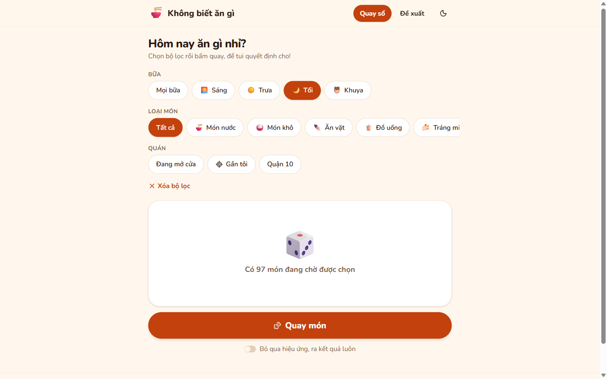
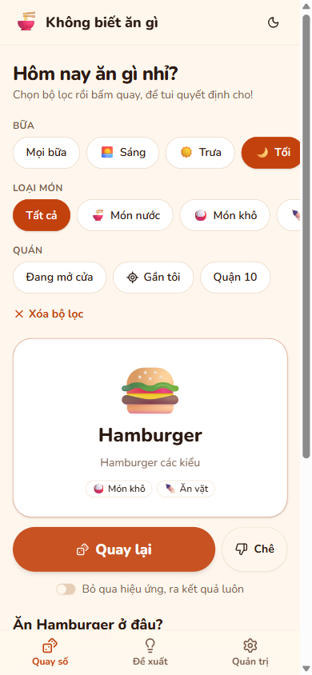
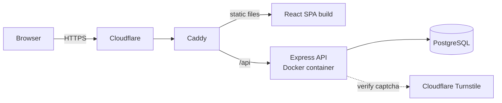

# Không Biết Ăn Gì 🍜

> *"I don't know what to eat"* — a web app that picks a dish for you, then tells you where to eat it.

**Live:** [khongbietangi.com](https://khongbietangi.com) · Vietnamese UI · mobile-first

<p align="center">
  
  &nbsp;
  
</p>

## Features

- **Weighted random pick:** filter by meal (breakfast, lunch, dinner, late night), dish group, district, *open now* or *near me*, then roll.
- **"Where to eat it?":** each pick lists matching places with Google Maps directions. *Near me* sorts places by GPS distance (haversine).
- **Reject for an hour:** a rejected dish leaves the rotation for 1 hour. Rejections are stored on the device, so no account is needed.
- **Guest suggestions:** anyone can suggest a dish or place. A pasted Google Maps link is resolved to coordinates server-side. Suggestions wait in a moderation queue protected by rate limiting, a 300-item pending cap and optional Cloudflare Turnstile.
- **Admin panel:** CRUD for dishes, dish groups and places, a review queue, usage stats, and feature flags (e.g. weighted picking on/off).
- Light/dark theme, confetti on each pick, and an option to skip the roll animation.

## Tech stack

| Layer    | Technology |
|----------|------------|
| Frontend | React 19, TypeScript, Vite, React Router 7, Tailwind CSS 4, shadcn/ui (Radix UI), react-hook-form + Zod |
| Backend  | Node.js 22, Express 5, TypeScript, Zod validation, helmet, express-rate-limit |
| Auth     | Admin login with bcrypt-hashed passwords and a JWT in an httpOnly cookie, with brute-force rate limiting |
| Data     | PostgreSQL via `pg` (hand-written SQL, versioned SQL migrations) |
| Infra    | Docker Compose (backend with health check), Caddy (static frontend + reverse proxy), Cloudflare |
| Tests    | Vitest unit tests for picking, filters, rejections, opening hours, Maps-link parsing and text normalization |

## Architecture



```
backend/     Express API (TypeScript): routes, services, SQL migrations, admin CLI
frontend/    React SPA (Vite): pages, components, pure logic in src/lib (unit-tested)
deploy.sh    VPS deploy: pull → build frontend → build backend image → migrate → restart → reload Caddy
```

## API overview

| Scope  | Endpoints |
|--------|-----------|
| Public | `GET /api/health` · `GET /api/catalog` · `POST /api/maps/resolve` · `POST /api/suggestions` |
| Auth   | `POST /api/auth/login` · `POST /api/auth/logout` · `GET /api/auth/me` |
| Admin  | `GET /api/admin/stats` · CRUD `/api/admin/{groups,dishes,places}` · `GET /api/admin/suggestions` · `POST /api/admin/suggestions/:id/{approve,reject}` · `GET /api/admin/settings` · `POST /api/admin/settings/toggle` |

## Running locally

Requirements: Node.js 22+, pnpm and a PostgreSQL database.

**1. Backend.** Create `backend/.env`:

| Variable           | Required | Notes |
|--------------------|----------|-------|
| `DB_HOST`, `DB_PORT`, `DB_NAME`, `DB_USER`, `DB_PASSWORD` | yes (port defaults to 5432) | PostgreSQL connection |
| `JWT_SECRET`       | yes | at least 16 characters, e.g. `openssl rand -hex 32` |
| `PORT`             | no  | defaults to `5000` |
| `TURNSTILE_SECRET` | no  | enables the captcha check on suggestions |

```bash
cd backend
pnpm install
pnpm migrate                              # apply SQL migrations
pnpm admin:create <username> <password>   # create an admin account
pnpm dev                                  # API on http://localhost:5000
```

**2. Frontend** (in a second terminal). Vite proxies `/api` to the backend:

```bash
cd frontend
pnpm install
pnpm dev                                  # app on http://localhost:5173
```

Optional: set `VITE_TURNSTILE_SITE_KEY` in `frontend/.env.local` to show the captcha widget.

**Tests:** run `pnpm test` in `frontend/` or `backend/`.

## Deployment

The backend runs as a Docker container (`docker-compose.yml`, health check on `/api/health`). The frontend is built into static files that Caddy serves, and Cloudflare sits in front. `deploy.sh` runs the whole release on the VPS. Step-by-step guides (in Vietnamese) are in [DEPLOYMENT.md](DEPLOYMENT.md) and [CADDY_INTEGRATION.md](CADDY_INTEGRATION.md).

## Author

**Hoàng Thụy** · [LinkedIn](https://linkedin.com/in/hthuy7605) · [GitHub](https://github.com/hthuy7605)

© 2026 Hoàng Thụy. All rights reserved.
